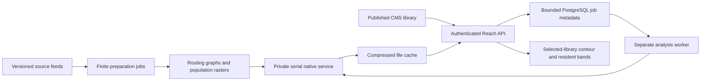

Atlas provides population density, individual-library Reach and combined Network coverage. Population density compares the average resident population per square kilometre of a reporting area. Reach estimates residents who could reach selected published Libraries within 5, 10, 15 or 30 minutes on foot or by bicycle. Density and Reach use different population sources and retain their reference years.

Reach supports fixed-location Libraries in England, Wales, Scotland and Northern Ireland when the UK profile is installed. Country support does not establish a complete library directory or guarantee that every origin is routable.

Enabled data layers appear as stacked cards beside the map, or within the mobile sheet. One card opens at a time; the others keep their selected scope and available headline figure visible. The open card uses the remaining height and scrolls internally, so the other layer summaries stay in view. Switching cards preserves the map, selected library or service, calculation and each card’s controls and scroll position. The open card is included in shared URLs as `analysis`.

Collapsing a card leaves its layer on the map. Turn the layer off in Layers to remove both it and its card. If that card was open, Atlas opens another enabled card. Area layers still replace each other; Reach and Accessibility can stay enabled alongside the chosen area layer. Summary figures retain their scope: Accessibility counts libraries in the current view; a Population reporting-area count comes from the selected service’s matching population grid. Incomplete or stale Reach results do not become current coverage percentages.

## Library networks and combined coverage

Library Networks are sourced institutional groupings, independent of Teams and of geographic placement. A Library can belong to several Networks. The non-localised `Library.networks` relation points to `library-network` records, with a stable source key, name, kind, countries and source reference. Network membership applies to Atlas maps, search, lists, population comparisons and exports. Population density remains independent of library filters.

Choose **Travel-time reach → Library service**, then find a service by name, country or region. The shared service picker searches the server in pages of 25; it never downloads a worldwide catalogue. Selecting a service fits the map to its eligible libraries. Calculate coverage starts the job explicitly. Country and region controls narrow the picker only. The same picker is available in Atlas Filters.

The default reporting boundary is the union of the supported districts containing all of the service’s eligible mapped libraries, before library filters apply. A service spanning several districts uses them together; Libraries NI therefore reports across its service area. This describes recorded locations, not a claimed legal jurisdiction. Library filters and panning do not change the reporting boundary. Update coverage after changing library filters, or reset those filters and recalculate if none match. Unrelated reporting-area overrides are rejected by the CMS. Results include cumulative resident totals, percentages, residents outside the threshold, coverage or gap geometry, and CSV/GeoJSON exports.

Service metadata rechecks canonical published members against the current Atlas coordinate and reporting-boundary projection. Missing or stale mapping prevents a complete result. Service searches and selected metadata are read afresh by the UI bridge; bounded public country/region facets are shared for one minute. The native service must be restarted after updating its Python calculation code; `pnpm dev` manages the service with the applications and workers.

The first version supports at most 250 published Network records per calculation and one installed routing/population release. Mobile and digital Libraries, planned and closed records are excluded. Unmapped eligible records prevent a complete gap calculation. Routes are estimated with the existing walking and cycling profiles; selecting an opening-hours filter selects recorded Libraries but does not model arrival-time opening hours. Accessibility filters describe recorded building features, not step-free routes.

Full-precision catchments are unioned before counting residents and clipped to the reporting boundary. Both covered and total residents use the same 2020 population grid. Overlaps count once. Unroutable origins or missing population suppress percentages and outside-population totals rather than becoming evidence of a gap. The native job reads bounded geometry and population files; PostgreSQL retains only bounded job metadata. Network identities include current membership/coordinates, filters, all reporting units, reporting geometry, mode and release, so old selections cannot serve changed facts.

The native boundary includes `networkJob` and `networkResult` contracts. Compatible result aliases may reuse a previous profile's cached individual-library results only when routing provenance, population provenance, coordinates, mode and analytical method all match. Expanding the supported origin catalogue does not require recalculating unchanged results.

## Four-nation local workflow

Reuse the local CMS, PostgreSQL, Meilisearch, Atlas projection worker and analysis service. The commands below are finite; they never start another stack.

```sh
node scripts/atlas/uk.mjs
node scripts/atlas/uk.mjs --stage=prepare --apply --local
node scripts/atlas/uk.mjs --stage=import --apply --local
node scripts/atlas/uk.mjs --stage=networks --apply --local
node scripts/atlas/uk.mjs --stage=backfill --apply --local
node scripts/atlas/uk.mjs --stage=verify

# With the analysis worker available, check real Networks and cached reads.
cd apps/strapi
node --import tsx scripts/ingests/uk/verify-networks.ts --local
node --import tsx scripts/ingests/uk/verify-networks.ts --local --mode=cycling
```

UK preparation reuses matching immutable graph/population assets. England, Wales and Scotland share the UK graph; Northern Ireland uses the full Ireland/Northern Ireland extract so its land-border routes are buffered. Both profiles activate atomically only after walking and cycling canaries in all four nations, including Newry near the land border, pass. The backfill waits for the existing projection worker to drain before admitting analytical jobs. The LibraryOn adapter accepts `GB-ENG`, `GB-WLS`, `GB-SCT` and `GB-NIR`, uses complete snapshots and exact current ONS district placement, and reconciles legacy source URLs to stable source IDs. Existing content differences become proposals; publication applies only to unchanged new drafts from that run. Network membership imports add sourced relations and field-level Change Records without replacing curated facts or publishing unrelated drafts. Existing conflicting service memberships require review. Libraries NI is one service; historical county segments in its source references are not separate services.

Private source snapshots, import reports and national/network acceptance evidence remain in ignored run/data directories. Inspect each nation's exceptions; a drained queue is not proof of complete routing or population coverage. The default reporting geography is ONS December 2023 districts, independently of current placement geography.

## Data and methods

| Input                        | Existing or added                             | Purpose and version                                                                                                                                                                                                                                                   |
| ---------------------------- | --------------------------------------------- | --------------------------------------------------------------------------------------------------------------------------------------------------------------------------------------------------------------------------------------------------------------------- |
| Published library records    | Existing; four-nation UK adapter consolidated | Original coordinates, physical library type, operating status and canonical country. Source refreshes preserve curated records and produce reviewable proposals.                                                                                                      |
| Administrative population    | Existing                                      | World Bank country observations and ONS local estimates, currently 2024. Stored on the owning geographic documents.                                                                                                                                                   |
| Reporting boundaries         | Existing, with added county metadata          | Country boundaries and ONS December 2023 UK districts. English county groups dissolve disjoint district memberships from the directory hierarchy.                                                                                                                     |
| Current placement boundaries | Added feed                                    | ONS May 2025 UK BGC v2 for all four nations. Used for directory placement, independently of the historical population controls.                                                                                                                                       |
| Routing network              | Added feed                                    | Versioned OpenStreetMap/Geofabrik UK and Ireland/Northern Ireland extracts. Preparation retains reference-complete routing data, access tags, restrictions and administrative relations. Valhalla builds country-aware routing tiles and its administrative database. |
| Resident count surface       | Added feed                                    | Native GHS-POP R2023A, 2020, 100 m, ESRI:54009. A buffered geographic window is read from the JRC-managed cloud raster using HTTP range requests.                                                                                                                     |

Density divides the administrative observation by measured boundary area, including inland waters. Country area measurements use generalized display boundaries and are approximate. Density is independent of library counts, search filters and recorded library completeness. A missing observation remains unavailable; a sourced zero is zero. County-group totals require every constituent district to have an observation from the same year. They are directory reporting groups, not guaranteed official ceremonial boundaries: Stockton-on-Tees spans Durham and North Yorkshire, while a whole-district observation cannot be split accurately between them. Exact ceremonial-county analysis would require matching official boundaries and compatible smaller-area population controls; do not split a district’s population in proportion to land area. See the [Ordnance Survey county boundary guide](https://docs.os.uk/os-downloads/products/areas-and-zones-portfolio/boundary-line/guide-to-ceremonial-county-boundaries).

Reach uses reverse network isochrones: travel towards the library. Walking has a 5.1 km/h baseline; cycling uses the hybrid bicycle profile with a 15 km/h baseline. Ferries are excluded. A suitable network edge must be within 100 metres of the recorded coordinate. The initial profile has no elevation model and does not model opening hours or temporary changes. Estimated travel times do not guarantee a step-free route.

An unroutable outcome also covers native catchment boundaries that are empty, incomplete, non-cumulative or cannot be repaired within the topology tolerance. The result records that reason and supplies no population estimate; smaller contours are not substituted for a missing larger catchment. These data/provider exceptions remain visible in country acceptance rather than consuming repeated retries or becoming zero residents.

Population is integrated using exact fractional intersections with equal-area raster cells. Prepared polygon predicates select cells; raster drawing is not used to decide which boundary slivers exist. Full analytical geometry feeds the population calculation; simplified geometry is used only for display and exports. Network display coordinates are rounded to six decimal places and repaired after rounding, with at most 240 kB per shape inside the 2 MiB result budget. Invalid source reporting boundaries are repaired before their service union; collapsed lines do not contribute population area. NoData is unknown rather than zero, independently of the size of a cumulative band. If any catchment lacks complete surface coverage, its count is unavailable and the response is marked partial, with the coverage fraction shown. Counts are cumulative potential catchment residents, not observed visitors. Never add overlapping library catchments to estimate combined coverage.

The 2020 surface is not silently adjusted to the 2024 administrative estimates. Barnsley and Sheffield's current placement codes changed in 2025; their older population reporting codes remain attached to the historical observations. These are separate boundary versions, not interchangeable aliases.

## Runtime and storage

See [Where Atlas data lives](atlas-data-storage.md) for the geographic schema
fields, durable job tables, prepared files and cache responsibilities.



The Strapi and Next.js processes do not build routing graphs or load global population cells. The native service is in `apps/analysis`, separate from the existing Node sync worker image. The analysis worker in `apps/sync-worker` claims durable jobs with leases and retries, then stores only result references in PostgreSQL. The map projection worker remains responsible for library publications and subsequent changes.

Default limits are deliberate:

- One native calculation at a time; a 256 MiB routing cache and windowed raster reads. Catalogue and cached-result reads can proceed while a calculation runs.
- Network jobs allow four minutes of native execution with a lease thirty seconds longer; the UI checks for up to five minutes before offering a progress retry. Individual-library jobs retain their ninety-second execution limit.
- Four fixed time bands, at most 2 million candidate population cells per individual catchment or 1 million per network reporting-area integration, and a 2 MiB result budget.
- One-library Reach requires zoom 11 or closer and at most 100 matching libraries in view. Named service calculations use canonical service and reporting bounds independently of camera zoom. Pro allows 50 eligible libraries, a 2,500 km² envelope / 75 km span for all four times, or 20,000 km² / 200 km for the selected time only. Active Team seats allow 100 libraries and double those area/span allowances. Both origin and reporting envelopes must fit. Changing a larger service’s time clears stale results and requires another explicit calculation. CMS and native admission independently enforce the budget before work or cache access.
- At most 10,000 job metadata rows. Jobs expire after seven days; account admission counters expire after two days.
- Compressed route and result files target a shared 256 MiB, seven-day cache and 20,000 artifacts. Pruning runs at startup and at most once per minute during calculations; provision headroom for intervening writes. Each artifact is limited to 2 MiB. After pruning, full-precision route reuse occupies at most one quarter of the cache budget and yields to user-visible results. Evicted results are calculated again when admitted; abandoned temporary writes are pruned.
- Pro permits 20 new calculations per hour; Team permits 100. Entitlements are checked before cached results and exports. Existing calculated results do not consume another run.
- Result checks and density requests also have a 60-per-minute account limit per UI process. This protects the CMS from repeated polling; the durable compute allowance remains independent. Density coalesces requests into three shared, one-minute cache entries, checked only after authentication.
- Coordinate, operating-status, type and publication changes invalidate analytical work through the map projection. The request also rechecks the current published CMS record before reading its cache.

Raw routing contours have a separate cache key from population results, so replacing a population release can reuse an unchanged network calculation. Network and population releases participate in result identities. Bump the graph builder/profile revision or analytical method revision when their behavior changes; do not reuse a release identity for changed routing assumptions. An active catalogue is replaced atomically only after a real routing/population canary succeeds. Requests outside installed country coverage return an explicit unsupported state.

`apps/analysis/contracts/reach.schema.json` is the machine-readable boundary contract. The native service validates private jobs and completed results against it; native and shared TypeScript tests consume the same conformance fixtures. Runtime geometry checks additionally enforce finite coordinates, closed valid rings, nesting, cumulative populations and byte/vertex budgets.

Raster cells, routing nodes and national collections of catchment polygons are never PostgreSQL records. Only the selected library's chosen contour reaches MapLibre. Country density reuses the existing Atlas PMTiles archive when its boundary version matches; it has an immutable GeoJSON fallback. English county-group and UK district display geometry are bounded static assets (48 and 361 areas), reused through the existing area renderer. A global rollout of detailed local boundaries must partition/tile those boundaries through the sync-worker archive pipeline rather than raising the 1,024-area response cap.

For global coverage, install country or explicitly partitioned profiles with buffered network/population inputs. Do not feed a planet PBF through an England-sized preparation budget or precompute every library globally. Large immutable release assets belong on a separately sized volume or object storage; retain only the active and required rollback editions. The England profile requires 14 GiB free after compact source preparation for a fresh graph build. The preparer preserves a 2 GiB reserve, leaving the previous active release untouched on failure. Completed parsing and base-tile checkpoints support resuming graph construction, replaying potentially torn last writes. Preparation and live serving need different memory/disk budgets.

## Local setup

Reuse the existing local PostgreSQL, Meilisearch, CMS and UI. Do not start a second app stack or database. Install the analysis environment with the hashed lockfile:

```sh
uv venv --python python3 apps/analysis/.venv
uv pip sync --python apps/analysis/.venv/bin/python apps/analysis/requirements.txt
```

Provide a private `ANALYSIS_SERVICE_TOKEN` of at least 32 characters and `ANALYSIS_SERVICE_URL` to the CMS and sync worker. The native service receives the same token, `ANALYSIS_DATA_DIR` and its bind address/port. Use `apps/analysis/.env.example`; local `run.py` reads the ignored `apps/analysis/.env`. Keep the private service behind the application boundary. `compose.example.yml` demonstrates a single limited runtime, without adding a database. The example volume must be writable by its non-root container user.

```sh
# Separate terminals/processes; start only missing services.
apps/analysis/.venv/bin/python apps/analysis/run.py
pnpm --filter @repo/sync-worker dev:analysis

# Show inputs, storage policy and required services; no writes or downloads.
node scripts/atlas/england.mjs
```

After this one-time setup, `pnpm dev` starts the application workspaces, Atlas projection worker, Reach job worker and native analysis service together. `pnpm dev:with-atlas` is an alias for the same startup. Turbo reserves enough concurrent task slots for these persistent processes and their shared builds. Startup does not build or download analysis assets.

The root shortcuts `pnpm dev:analysis:service`, `pnpm dev:analysis` and `pnpm dev:atlas` remain available for starting individual missing processes. The service runs from `apps/analysis`, so its default `data` directory and local `.env` resolve consistently. Reuse an already running analysis service and worker when restarting only the UI.

## Atlas list ordering

The list defaults to name order and retains the selected order in the Atlas URL.
Name, place and record completeness each support both directions. Their signed
cursors use the sort value and a stable Atlas ID to continue through ties without
duplicates. Unscored records appear last in either completeness order and are
labelled “Not scored”. Exports use the same selected order. The worker enables
`completeness` as a sortable attribute on existing and staging indexes.

Nearest-centre ordering remains capped at 1,000 results. Its footer explains the
cap and distinguishes that reachable set from the complete matching total;
the other orders can continue through every matching record.

Selecting a library row opens its Inspect drawer without moving the map or
resetting the list's sort, page or scroll position. Desktop keeps the results
beside the drawer; mobile offers “Back to results”. Closing the drawer returns
keyboard focus to the selected row. Persistent “View library” and “Improve this
record” actions link to the full page and existing Index editor respectively.
The editor route retains its sign-in, staff routing and moderation rules.

## Recorded library density

Library density has its own renderer and analysis drawer, independent of pin
clusters. The default grid shows recorded libraries per 100 km². Each count uses
the full geographic cell area, including water, measured on a sphere. Mercator
cells at the same resolution have different geographic areas at different
latitudes; their screen area is never the denominator. This measure is separate
from residents per km², libraries per resident and travel-time Reach.

Automatic detail uses cell resolution `floor(map zoom) + 4`, bounded to 4–20.
Preferred continental, regional, local and neighbourhood resolutions are 6, 10,
14 and 18. Grid shading stays visible at street zoom; library locations are an
independent overlay. A fixed scale uses 0, 0.1, 1, 5, 20 and 100 libraries per
100 km², with values above 100 retaining the darkest colour. Local contrast
stretches that scale to the highest intersecting cell value and labels the
changed breaks. Smooth concentration uses the same grid with a relative kernel
display; its colours do not claim numeric density. Inspection always reports
the original cell count, area and unsmoothed rate.

The Atlas archive build prepares sparse count grids from the same published
point snapshot at every display zoom, 0–16. The separate `density.pmtiles`
contains numeric cells and their centres, not pin cluster anchors or a dense
global raster. Preparation retains one resolution at a time, with a one-million
occupied-cell limit per resolution and a 1 GiB intermediate-file limit. The
native validator inspects every tile, checks counts and geographic rates against
the source, and rejects any dropped cell at any zoom. Existing tile byte and
feature limits apply. Delivery, hashes and immutable publication are checked
before the shared manifest pointer changes. Archive retention removes density
with the rest of its generation. The tile-runner image includes
`validate_density.py` beside the point and country validators.

Only an unfiltered, automatic, fixed-scale request whose indexed revision
exactly matches an unchanged archive snapshot can use prepared density. Changed
coordinates, deletions, closures, filters or index generations use current counts
instead. An old aggregate is never combined with an additions-only point overlay.
Current queries snap outward to complete cells and include a three-cell halo so
viewport edges do not truncate counts or smoothing. The visible-library total is
still calculated within the actual viewport. A boundary cell can therefore
contain more records than are visible inside the viewport.

Current responses retain the 2,048 occupied-cell cap. Truncated facets cause a
complete coarser resolution, with the change explained in the drawer. Bounded
small selections use original point coordinates for finer cells. The additive
index upgrade adds z13–20 cell fields; a normal staging index rebuild derives
them from older projections without editing canonical CMS records. Before the
upgrade, queries can fall back to the complete z0–12 fields. Density viewport
responses use the existing bounded 15-second cache, keyed by filters, camera,
settings, index revision, dictionary, generation and opening-time evaluation.

The drawer owns presentation, preferred detail, smoothing distance, colour scale and opacity. Smoothing offers one, two or three cell widths, with an approximate distance at the map centre. These
choices persist in Atlas URLs. Map key and drawer use one palette definition.
Selecting a cell shows its count and area and offers a camera action. Missing
records do not establish that an area has no library.

## Population and neighbourhood context

Population now supports automatic detail, official area averages, a searchable
area picker and a resident grid. Automatic detail moves from country averages
to local areas at zoom 6, then to the installed grid at zoom 9. A selected area
fits the map to its boundary. The analysis panel owns these controls; library
filters do not change the underlying population.

Automatic detail follows the map. Its global area picker includes countries
without installed local profiles; the separate supported-country selector appears
only when choosing local or grid detail explicitly.

The current administrative profiles cover countries worldwide, 361 UK districts,
48 English county reporting groups, Sweden's 290 municipalities and 21 counties,
mainland Finland's 292 municipalities and 18 regions, and Åland's 16 municipalities
and three subregions. Newer geographic observations retain their own source year.
Finnish mainland totals exclude Åland, which is reported separately. Norway and
Denmark's newer country totals are available; municipal maps require an installed,
licensed boundary profile with matching codes and boundary vintage. Eurostat's
GISCO LAU download has a non-commercial restriction and is not used here.

The UK resident grid displays the already prepared GHS-POP 2020 R2023A surface.
It is a separate measure from newer official population estimates. Preparation
copies the raster and builds display overviews; it never changes Reach's source
raster. Zoomed-out tiles average source cells for display. Point inspection uses
the native cell value and equal-area cell size. Display tiles never feed an
analytical resident count. The prepared extent can include neighbouring land.

Deprivation is a Pro/Team background layer with four separate national releases:

| Nation           | Edition                      | Statistical areas     |
| ---------------- | ---------------------------- | --------------------- |
| England          | IMD 2025, corrected workbook | 33,755 2021 LSOAs     |
| Wales            | WIMD 2025                    | 1,917 2021 LSOAs      |
| Scotland         | SIMD 2020v2                  | 6,976 2011 Data Zones |
| Northern Ireland | NIMDM 2017                   | 890 2011 SOAs         |

Ranks and deciles remain national. Rank 1 is most deprived; deciles describe
groups of areas, not shares of residents. Northern Ireland's deciles are derived
from ranks, with 89 SOAs per decile. Do not compare ranks between nations or
interpret them as individual circumstances. The source edition, boundary year,
licence and attribution accompany every release.

Households without a car is a second Pro/Team background, using ONS/Nomis Census
2021 TS045 for England and Wales. Its denominator is **households**, not people.
The percentage is households with no car or van available divided by all
households. Each release must match every source LSOA code before publication.

Reach can overlay any one background. Its contours become outlines with a light
fill so the context stays readable. Existing network coverage totals still use
the network's reporting area and original population grid. The display layer supplies context only. The separate analytical deprivation index below supplies population-weighted comparisons; map colours and simplified display boundaries never feed those calculations.

### Preparing context releases

Install the hash-pinned analysis requirements first. Reuse the existing local
database, applications and prepared Reach surface. From `apps/analysis`:

```bash
.venv/bin/python prepare_context.py population
.venv/bin/python prepare_context.py england
.venv/bin/python prepare_context.py wales
.venv/bin/python prepare_context.py scotland
.venv/bin/python prepare_context.py ni
.venv/bin/python prepare_context.py cars
```

`cars` requires the England and Wales boundary releases. Administrative preparation
requires a country observation snapshot from the private geographic bridge,
`/api/atlas/population/context?country=SE` (or `FI`/`AX`). Keep credentials server-side
and snapshots outside Git, then run:

```bash
.venv/bin/python prepare_context.py sweden --observations /tmp/population-SE.json
.venv/bin/python prepare_context.py finland --observations /tmp/population-FI.json
.venv/bin/python prepare_context.py aland --observations /tmp/population-AX.json
```

Preparation retains bounded downloads and SHA-256 source records under ignored
`data/context/sources`, checks area counts, unique codes, complete joins and valid
values, then publishes immutable assets and an atomic catalogue. A failed import
leaves the previous catalogue active. The display vectors are simplified; point
lookups close to a border are approximate. Original downloads remain available
for future analytical preparation. Do not use display geometry for precise site
analysis.

The browser receives bounded 256-pixel tiles, 30-area search pages and single
point lookups through the authenticated Next.js → private Strapi → analysis bridge.
Small-area lookups and tile candidates use prepared SQLite spatial indexes, so
opening one area does not decode a whole country's polygons. Existing context
assets can gain these indexes with `prepare_context.py index`.
Population is available to signed-in accounts; deprivation and car availability
require `atlas.analysis`. Large grids and national small-area vectors stay out of
CMS records and browser bundles. Tile concurrency, catalogue size, search length,
asset size and in-memory caches are bounded. Missing data remain transparent;
known zero remains a measured value.

The CMS migrations create owned analysis tables and grant access only to existing Atlas writers. They do not grant the worker access to CMS content tables. A mismatched bridge credential must be corrected against the intended local CMS, never worked around with broader database permissions.

## England import and acceptance

The country command runs finite, sequential stages. It does not launch servers. Inspect the plan first; `--apply --local` explicitly selects the local test stack.

```sh
# Refresh/reconcile existing administrative population controls.
node scripts/atlas/england.mjs --stage=controls --apply --local

# Prepare routing and resident surfaces, then validate and activate a release.
node scripts/atlas/england.mjs --stage=prepare --apply --local

# Complete directory snapshot, current placement, draft import and publication
# of only the unchanged new drafts in that successful local run.
node scripts/atlas/england.mjs --stage=import --apply --local

# Scan every published library in England, queue both modes, drain and verify.
node scripts/atlas/england.mjs --stage=backfill --apply --local

# Verify every result artifact, its current coordinate identity and four bands.
node scripts/atlas/england.mjs --stage=verify
```

`--stage=all --apply --local` runs the whole sequence. `--refresh` reacquires mutable routing/library feeds; a LibraryOn `--snapshot=/absolute/directory` replays its complete saved source and placement snapshots offline. Without `--apply`, preparers and ingests report their work. The verifier reads the active release and existing artifacts. Source hashes, retrieval dates and import logs are kept under ignored data/run directories. Applied backfills repair evicted result artifacts and explicitly retry exhausted failures; dependency outages preserve existing work. A rerun matches numeric source IDs and uniquely reconciled legacy URLs; it does not duplicate existing libraries or replace curated facts.

Verification writes `acceptance/england-reach.json` inside the ignored analysis data directory, including every checked result identity and every exclusion/exception. Use `--report=/absolute/path.json` to choose another private destination. `complete` means all eligible jobs were accounted for without missing/failed artifacts; `fullCoverage` also requires no unroutable origins or partial population bands.

Every source library is mapped or has a skip reason. Missing coordinates, ambiguous geography and points outside the current clipped boundary are quarantined for review. Missing source IDs are reported, never automatically closed or deleted. Existing-source differences are saved as proposals. The old LibraryOn path is available with `--legacy=true` for workflows outside the England profile.

Keep the ordinary Atlas projection worker running so new publications reach the map and search index. The analytical backfill independently scans canonical published CMS records, including libraries from other sources. It excludes mobile/digital, permanently closed, planned and unmapped records. Verification distinguishes failed/missing artifacts, explicit unroutable records and incomplete population coverage; do not describe a queued or partial run as complete national analytical coverage.

Supporting-data updates are separate from library refreshes. Pin a new population edition ID and source URL/year before preparing a replacement surface; immutable editions are reused and hash checked. Refresh the mutable routing extract with `--refresh`. Activate the staged pair only after its canary passes, then run the backfill/verification stage for the new identities. When the checked-in reporting boundaries or directory membership change, regenerate density metadata and display geometry with `pnpm --filter @repo/sync-worker atlas:population:geometry` using `ANALYSIS_PYTHON` for the prepared Python interpreter, and rebuild shared data before the UI. Routine population-observation imports do not require rebuilding unchanged boundaries.

Before release, record the complete source/import counts, both mode outcomes, partial/unroutable exceptions, populated band counts, graph/raster/cache/database bytes, first and cached calculation latency, queue recovery after interruption, original-coordinate invalidation, entitlement/export checks, and desktop/mobile map acceptance. These are local feature checks; production promotion follows the existing private deployment runbook and does not follow automatically from the test import.

## Sources

- [JRC GHS-POP dataset](https://human-settlement.emergency.copernicus.eu/ghs_pop2023.php) and [JRC-managed cloud registry](https://registry.opendata.aws/ghs-pop/), CC BY 4.0.
- [Geofabrik UK extract](https://download.geofabrik.de/europe/united-kingdom.html) and [Ireland/Northern Ireland extract](https://download.geofabrik.de/europe/ireland-and-northern-ireland.html), OpenStreetMap contributors, ODbL 1.0.
- [ONS current placement boundaries](https://services1.arcgis.com/ESMARspQHYMw9BZ9/arcgis/rest/services/LAD_MAY_2025_UK_BGC_V2/FeatureServer), OGL v3 with OS/ONS attribution.
- [ONS population estimates](https://www.nomisweb.co.uk/datasets/pestsyoala) and [World Bank population series](https://data.worldbank.org/indicator/SP.POP.TOTL).

## Scientific audit and interpretation

The audit followed the published CMS service selection through the durable job,
native router, population integrator, result contracts and browser exports.
`engine.py` generates reverse Valhalla isochrones towards each library, validates
and nests 5/10/15/30-minute geometries, and retains unsimplified route artifacts.
`network_reach.py` unions eligible branches, clips to the reporting-district union
and integrates the same GHS-POP surface for both numerator and denominator.
`population.py` reads bounded raster windows and allocates resident estimates by
exact cell-intersection fractions in the equal-area raster CRS. It assumes a
uniform distribution inside each 100 m cell. Known zero is zero; any NoData in an
analytical region prevents a complete count. These are modelled residents, not
an administrative headcount, observed visits, admission or effective access.

The most material weaknesses were interpretive and cross-layer: cumulative
counts could be mistaken for separate time bands; “outside” had no explicit time
qualifier; display deprivation boundaries were being overlaid without a numerical
population join; and exports did not retain the complete eligible-library
snapshot. The implementation now supplies distinct bands, threshold-specific
labels, deterministic observations, a population-weighted comparison and versioned
provenance. An arbitrary walking time is an analytical choice, not a jurisdictional
accessibility standard. Residents beyond it must not automatically be described
as underserved.

Service membership, reporting geography and map visibility are separate. The
reporting area is inferred from eligible service locations before filters. Its
population does not change with the camera or library filters. Other services,
including accessible libraries just across a boundary, are excluded. Service
members outside a deliberately narrowed reporting area can still contribute
routes into that area. The current result does not claim an exact number of
eligible branches visible on a clustered or paged map. The district boundary
source is generalised and clipped: exact fractional integration cannot recover
precision absent from that boundary. Nearby-border estimates remain approximate.

The UI derives mutually exclusive bands as C5, C10−C5, C15−C10, C30−C15 and
T−C30 from unrounded complete cumulative estimates. The chart uses equally sized
category rows and a population-share scale, rather than implying equal-duration
histogram bins. Cumulative rows remain available and selecting one updates the
map threshold. Missing or non-monotonic inputs cannot generate a distribution or
narrative finding. Floating-point tails within the existing network precision tolerance are bounded to the denominator for presentation. Values are rounded only for display; rounded parts may differ
from a rounded total. Observations describe additional residents and those beyond
the maximum time. They do not infer usage, causal effects or statistical correlation.

## Population-weighted deprivation reach

`prepare_community.py` reuses the existing official code joins and snapshot
acquisition, but publishes a separate immutable SQLite RTree index before display
simplification. England uses the ONS full-resolution clipped 2021 LSOA layer
(BFC), joined exactly to the corrected IMD 2025 workbook. Scotland, Wales and
Northern Ireland retain their source boundary editions and original vertices
(the Scottish API snapshot rounds coordinates to six decimal places). Repaired
zero-area boundary spurs carry no population. Every national import checks unique
codes, valid deciles and the full expected area count before atomic catalogue
publication. Source snapshots retain request URLs, retrieval metadata and hashes;
analytical releases include an asset SHA-256 and content-derived identity.

Prepare the matching display edition first, then run these finite commands from
`apps/analysis`. Run preparations sequentially; no application or database starts:

```sh
.venv/bin/python prepare_community.py england
.venv/bin/python prepare_community.py wales
.venv/bin/python prepare_community.py scotland
.venv/bin/python prepare_community.py ni
```

The existing network worker computes the comparison once with the combined Reach
result. Routing, full unions, job admission, leases, cache and account limits are
reused. The community release identity is part of the canonical selection hash;
changing editions invalidates cached comparisons. A compatible single national
edition is required for every reporting district. Cross-nation category scales
are rejected, rather than pooled. Opening “Community context” reads the existing
bounded result; changing the time selects one of its four already computed bands.
Large vectors and grids stay server-side. Optional community integration has an
80-million-candidate-cell budget, in addition to each 30-million-cell integration
limit and the existing four-minute network job deadline. An unavailable edition,
incomplete base result or failed reconciliation supplies an explicit unavailable
state, never fabricated zero coverage. The underlying Reach result is preserved
when optional integration exceeds its data or calculation budget.

`community_reach.py` projects source polygons, the reporting area and the full
catchment union into the population grid CRS. It dissolves national decile pairs
1–2, 3–4, 5–6, 7–8 and 9–10 into five groups and clips them to the reporting area.
Within-group overlaps dissolve. Cross-group conflicts become unclassified.
Uncovered boundary slivers and missing classifications also remain unclassified.
Each group's population and its intersection with each catchment use the existing
fractional cell integrator. It never averages ranks, counts areas equally or
classifies a whole cell by its centre. Known-group totals plus unclassified
population must reconcile with the reporting denominator; within-group counts
must reconcile with each network band. The tolerance is 0.01 residents or 1e-8 of
the reporting population, whichever is larger. Reconciliation failure suppresses
all category percentages.

For group g and threshold t:

- Coverage = within(g,t) / total(g) × 100; an empty group has no rate.
- Beyond(g,t) = total(g) − within(g,t).
- Share of all beyond = beyond(g,t) / beyond(all,t) × 100. This denominator includes
  unclassified residents; it is not the share of known-group residents alone.

Unknown classification is separate and excluded from comparisons of highest and
lowest known-group coverage. Differences are reported in percentage points, with
both groups named. They are descriptive observed differences in this model.
National indices and editions are not directly comparable; their areas have
unequal populations. The population grid is 2020, while index editions and
boundary years differ. An area's relative deprivation does not describe every
resident. Overall SIMD includes access to services, so the comparison is partly
confounded by that domain. Independent income and employment comparisons are
not implemented; those require separately versioned domain ranks, validated
national grouping rules and matching result/cache identities. No causal or
correlation claim follows from these group rates.

### Exports and reproducibility

Existing network CSV columns and feature properties remain compatible. GeoJSON
adds a foreign `analysis` member with export version 2, the eligible-library
snapshot (public IDs, coordinates and coordinate hashes), service and filter
exclusion counts, boundary identity, routing/population releases, selected time
and community result. Its geometry remains simplified for display and must not
be used to reproduce analytical counts. The new **Analysis JSON (v2)** download
retains the unrounded result, all groups and thresholds, current parameters,
calculation timestamp and source provenance. Network `snapDistanceMetres` is a legacy scalar placeholder (zero), not a measurement of every branch; individual snap distances are not retained. Origins still require a suitable route within 100 metres. Retain the JSON alongside a CSV when
reusing the figures. Reproduction also requires the pinned native source assets
and routing implementation, rather than the exported display polygons alone.

### Scenario modelling extension points

The existing native network job already carries a bounded, explicit origin set,
coordinate hashes, reporting boundary and release. A future server-authorised
scenario can derive that set from a canonical base snapshot, apply add/remove/
relocate operations, and call the same full-contour union and community
aggregation. Route caching reuses unchanged coordinates. Keep the base reporting
boundary, population grid, deprivation edition and time thresholds fixed across
baseline and alternative; compare unrounded totals and each group's numerator.
Scenario identity must include the base selection hash and every operation.
Hypothetical origins need distinct IDs and must never be published as library
facts. Reject client-supplied arbitrary analytical polygons.

Total marginal reach and changes for particular deprivation groups answer
different questions. Removing a branch's individual catchment population is
not its marginal network effect because other branches overlap it. Mobile stops
also require schedules, dwell times, eligibility and an arrival-time model; they
cannot be treated as always-open fixed branches. These scenario authorisation,
snapshot-comparison and time-dependent models are not built by this change.
International expansion needs licensed analytical boundaries, edition-specific
classifications and a population surface compatible with the reporting geography;
a country-level visual overlay alone is insufficient.

### Local validation, 25 October 2026

Native replays used actual saved library IDs, coordinates, reporting codes,
routing/population releases and the newly prepared national analytical indexes.
The warm-route, full-aggregation checks took approximately 3.3 seconds for
Aberdeen City, 5.5 for Cardiff, 4.3 for Leicester and 6.5 for the Belfast reporting
area using Libraries NI's 97 eligible branches. These are local checks, not a
cold-route or production performance guarantee. All six population groups
(including unclassified) reconciled with each reporting denominator and all four
coverage numerators. They also passed the shared TypeScript result validator.

Aberdeen City's 11-branch walking replay reproduced the reference denominator
227,563.9875 and cumulative residents 18,527.7227 / 62,732.0052 / 110,879.2982 /
208,113.4124. The dynamically derived rounded distinct bands are 18,528 / 44,204 /
48,147 / 97,234 / 19,451. Coverage is 48.7244% at 15 minutes and 91.4527% at 30.
This verifies the screenshot arithmetic for those matching inputs; it does not
validate actual travel times or attendance against independent field observations.

A separate 97-branch calculation across all 11 Northern Ireland districts took
59.2 seconds and returned **partial**. Every requested catchment had complete
population coverage and no origin failed routing, but the reporting-area union
intersects NoData in the installed GHS-POP surface. Its total population is
therefore unknown; national coverage percentages, beyond-threshold counts and
community comparisons are correctly withheld. A successful Belfast-area check
must not be presented as complete national population coverage. Enabling that
national denominator requires a compatible complete population release or an
independently justified land/water mask and documented NoData rules. Do not fill
unknown cells with zero or mix a newer administrative total into this model.

Synthetic analytical tests cover fractional cells with unequal population,
within-class deduplication, conflicting classes, explicit missing classifications,
NoData, zero denominators and reconciliation failures. Contract and UI tests
cover mutually exclusive versus cumulative bands, missing-data narratives,
cross-nation rejection, parameter matching, eligibility, stale selections and
legacy CSV/versioned export behaviour. Ignored acceptance records are saved in
`apps/analysis/data/acceptance/reach-rigour-*.json` for local replay evidence.

## Selected-time capacity and admission

The UI reads `analysisAreaMultiplier` from the authenticated session. Active Team seats receive multiplier 2 and 100 new analyses per hour; Pro receives multiplier 1 and 20. Team seating does not change the personal Pro plan or Library staff permissions. The Next bridge forwards this trusted multiplier separately from the public request. Browser capacity, members and arbitrary shapes are rejected. CMS derives current members and reporting geography before checking cache/admission; native validation independently checks count and both geographic envelopes.

Ordinary jobs request four contours. Expanded jobs require `minutes` (5, 10, 15 or 30), pass just that contour to Valhalla and count only that catchment. Their results include `requestedMinutes`; parsers require exactly the matching contour. Changing time changes the draft/job/routing key, hides stale map geometry and exports, and requires another explicit action. Distinct interval distributions and additional-time insights are unavailable from one generated time. Optional community categories reconcile against the single matching base contour.

The native raster reader retains 256 × 256 chunks. Ordinary network jobs allow 1 million candidate cells per integration for Pro, 2 million for Team; selected-time jobs allow 3 million / 6 million. There are five base integrations for four times, or two for one time, before denominator cache reuse. Optional community integration has a separate total 12 million / 24 million candidate-cell budget; exceeding it returns insufficient context while preserving valid base Reach. Existing job timeout, single compute slot, queue cap, 2 MiB result cap and 256 MiB / seven-day shared artifact cache remain. Geographic admission is not a guarantee that every graph or raster job completes inside its budget.

Country averages, grid density, library-directory completeness and Reach availability remain separate. New country records never imply that its population/routing pack is installed. See the production Knowledge guides on Reach, population/context and partial records. The Atlas content updater publishes corrections for already-deployed features separately from staging expanded-capacity descriptions; do not publish staged capacity claims before release acceptance.
