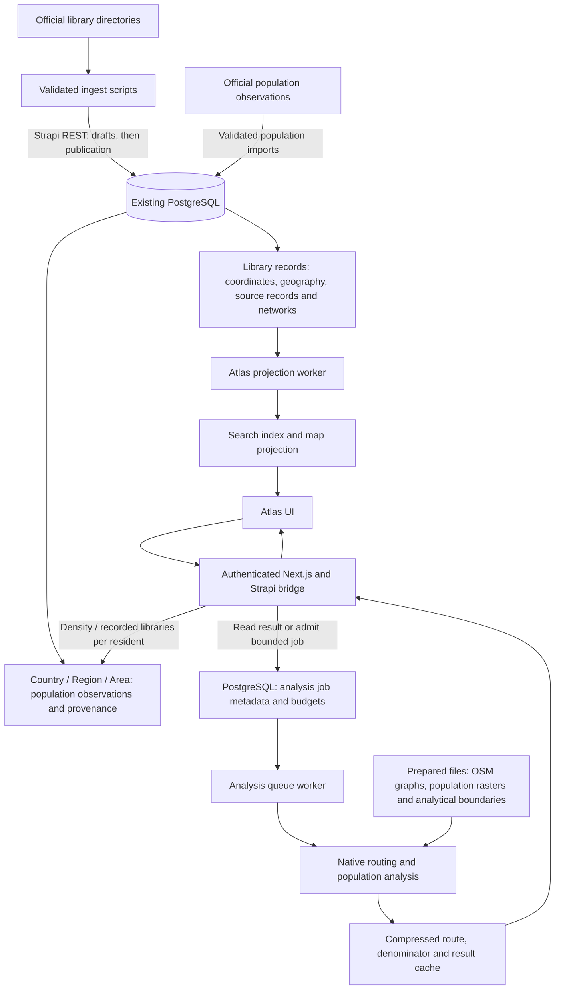

Atlas uses the existing Strapi PostgreSQL database, prepared analytical files and a bounded result cache. Adding the native analysis service does not create another PostgreSQL database.

## Place population fields

The Country content type has a numeric `populationCount`. Its older `population` string is display text and must not be used as an analytical denominator.

Region, Area and Continent have a numeric `population`. These place types also carry `populationYear`, `populationSource`, `populationSourceUrl`, `populationLicence`, `populationRetrievedAt`, `populationReportingCode`, `populationMethod` and `populationCoverage`.

Each place's private `populationEstimates` JSON retains sourced observations, including older editions. An observation has a stable key, reporting code, geographic level, population, year, source URL, licence and retrieval date, with boundary and coverage metadata where applicable. The selected numeric fields provide the current supported summary. Site Config's private `populationEstimates` holds world observations.

These are fields on the geographic documents, not a separate population-observation content type. PostgreSQL stores their snake_case columns in `countries`, `regions`, `areas`, `continents` and `site_configs`.

The Library content type stores coordinates in `location`, geography relations, `sourceRecords`, recorded services/accessibility and `openingTimes`. Its `networks` relation points to sourced `library-network` records. A Library does not store its surrounding population cells or a permanent reach percentage.

## Analysis metadata in PostgreSQL

`atlas_records` is the derived map/search projection, independent of canonical Library content. `atlas_outbox`, `atlas_changes`, `atlas_state` and `atlas_index_batches` coordinate projection updates and indexing.

`atlas_analysis_jobs` stores a request identity, library/network identity, coordinate/selection hash, routing/population release identity, travel mode, bounded server-resolved payload, state, result key, claim/retry metadata and expiry. The current payload constraint is 128 KiB. This is a durable work queue, not a table of every resident cell or polygon.

`atlas_analysis_budgets` records usage windows for admission control. The analysis worker uses a restricted database role; it does not need permission to rewrite canonical Library records.

## Prepared analytical files

The native service reads versioned routing graphs built from OpenStreetMap extracts, resident-count GeoTIFF rasters, full analytical reporting boundaries, and indexed socioeconomic boundaries. SQLite spatial indexes are files used to find nearby polygons; they are not another PostgreSQL service.

`active.json`, `reporting-areas.json` and the context/community catalogues identify the installed releases. They retain source years, licences, geographic coverage and file identities. Display tiles and simplified map polygons do not feed resident calculations.

Preparing these files is the expensive download/build step. A normal website request does not download OSM or rebuild a national graph. Large-country expansion needs additional prepared regional assets and measured storage/memory capacity.

## On-demand calculation and caching

The bridge resolves an eligible published Library or supported local service and checks geographic/size limits before admitting a job. A request key includes the relevant location/selection, travel mode and data release. A compatible ready result can be returned immediately; otherwise the queue worker asks the native service to calculate it.

The native service routes walking or cycling catchments for 5, 10, 15 and 30 minutes, then reads only the intersecting population-raster windows. Service coverage unions catchments before counting residents, so overlap is counted once. A percentage uses the same grid for its covered and reporting-area populations.

Full-precision routes, reporting-area population denominators and user-visible results have separate compressed cache entries in the same total budget. Denominator identity includes the complete analytical area, boundary edition, population edition and files; changing travel time alone can reuse it. Network job identities include trusted capacity and the requested time (or all four). A selected-time result carries requestedMinutes and exactly one contour; it never fabricates distribution bands. Artifacts expire after seven days. The default total cache budget is 256 MiB, with pruning and a smaller route-cache allowance. The PostgreSQL job also has an expiry; a ready metadata row with an evicted artifact is not sufficient to return a result.

Changing coordinates, membership, filters, mode or data editions changes the relevant identity or invalidates the job. A cache miss is recalculable; an imported Library never receives a permanent coverage value.

## Missing data

- A missing pin leaves a Library available in the directory but unavailable as a fixed map/routing origin.
- Library access rates use the mapped Atlas index. Published records without usable coordinates are excluded from those counts, even when their country is known. Population density remains independent of library records.
- Unknown hours do not mean closed. An opening-time filter requires recorded schedule data; it does not model arrival-time opening during a Reach journey.
- Missing building accessibility does not mean an inaccessible building. A walking route does not establish step-free access.
- Missing official population leaves density/per-capita unavailable. It is not zero.
- Missing routing or resident-grid coverage returns an unsupported or partial state. Incomplete denominators suppress coverage percentages and beyond-threshold counts.
- Administrative population, modelled grid residents and socioeconomic household counts can have different years and universes. Keep their source labels and denominators separate.

See [Atlas analysis](./atlas-analysis.md) for the calculation methodology, country support, local query limits and preparation commands.
