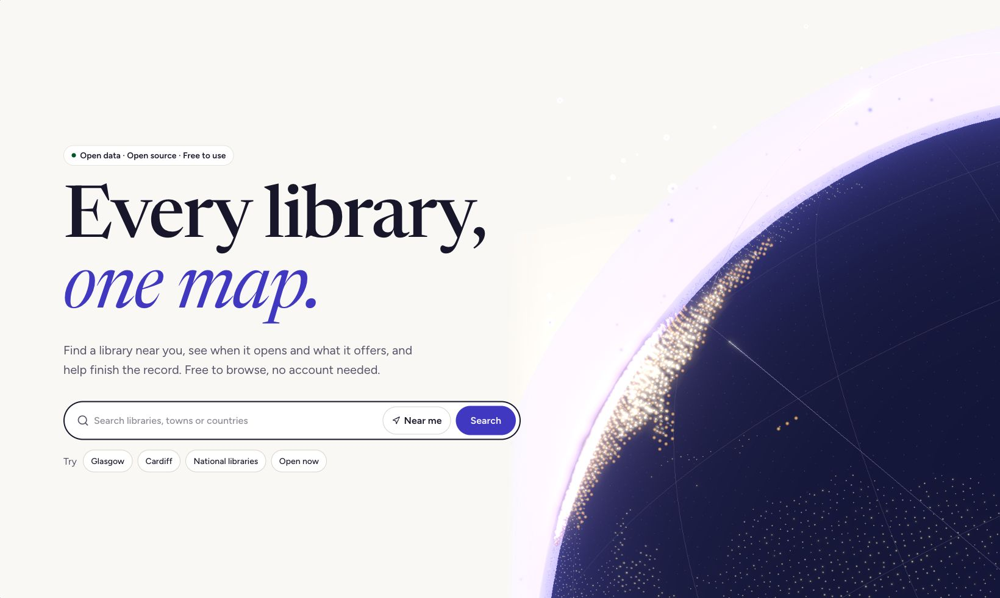

# A darker reading room, and a more consistent Libraries Global

Dark mode is coming to Libraries Global as part of a wider interface overhaul. Here is a first look at the design, and the small changes behind it.

Libraries Global has grown into several different kinds of place. You can look up an opening time, explore the Atlas, read a story, join a conversation or look after a library's record. Each task asks something different of the interface. A long article needs room to read. A staff workspace needs clear actions and a reliable account of what you can do.

We have been working on making those places feel more connected. Dark mode is the next part of that work: a second appearance that keeps the same type, hierarchy and indigo character.

These are screenshots from a development build. Dark mode and its appearance controls are coming to the site, but have not shipped yet.

Development preview of the Journal in dark mode. Includes labelled demonstration stories; dark mode has not shipped yet.

## The same place, after dark

The light appearance takes its cues from a reference book: a warm page, dark ink and headings with a little space around them. The dark design moves to deep indigo surfaces, softer light text and violet accents. Panels still need to feel separate from the page behind them. Links still need to look like links.

We want both appearances to feel considered. Dark mode will not invert photographs or turn every border bright. Library categories will keep their familiar colour families, with labels alongside them. A pending request will still say what is pending.

The development build offers Light, Dark and System. System follows the preference reported by your browser. An explicit Light or Dark choice takes priority. The header and account settings use the same preference, with account saving for signed-in readers.

Development preview of the same Journal in light mode. The coming release will offer Light, Dark and System in the header and account settings.

## Familiar controls, wherever you are

The wider overhaul is also about repeated details. Page titles, status labels, search fields and action rows should work predictably as you move between sections. Reusing those parts gives us fewer places to fix when a control needs better keyboard behaviour or a clearer error message.

There is room for different personalities. The Journal can have an editorial pace; the Atlas needs practical map tools. Sharing a button or a page-header pattern does not mean giving every section the same layout.

The staff area makes the distinction especially clear. Team membership, verification and permission to manage a library are different things. A tidy banner must explain them accurately. Paying for membership does not become a shortcut to library authority because the labels happen to sit together.

An excerpt from our development homepage. Dark mode is coming with the interface overhaul; it has not shipped yet.

## Checking more than the palette

A theme reaches further than the page background. Menus, forms, charts, map controls, editors and loading states all need attention. So do focus indicators, text at high zoom and messages that appear when something goes wrong.

We are using the rollout to review those details in both appearances. Our target is WCAG 2.2 AA. That is a standard to test against, rather than a claim that a dark palette automatically makes a site accessible. Automated checks will sit alongside keyboard, screen-reader and zoom testing.

Our development component library, Storybook, has appearance controls too. It gives us a place to inspect the actual controls in light and dark, including the less photogenic states: saving, empty, disabled and failed.

There is more about the thinking in [How the site is designed](/knowledge/design-system/how-the-site-is-designed), with new notes on [colour and appearance](/knowledge/design-system/colour-and-appearance), [accessible interaction](/knowledge/design-system/accessible-interface-interaction) and [shared components](/knowledge/design-system/shared-components-and-section-identity).

It is good to see the pieces coming together. We will update this post when the controls are available. For now, this is a look at the reading room we are getting ready to open after dark.
