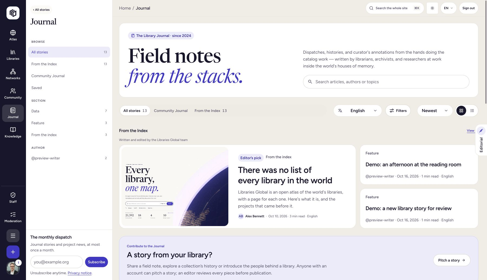
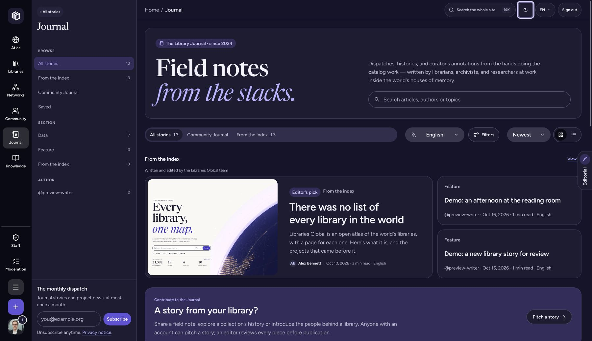

# Dark mode implementation

The application now supports Light, Dark and System appearances. This is a source implementation with local verification; production deployment is a separate release step.

## Preference behaviour

The header has a radio menu with three choices. Account settings has the same choices in a dedicated Appearance section, separate from the avatar palette. The mobile navigation shows one appearance control. English, French and Czech labels are included.

System is the default for a browser without an explicit choice. It follows live changes to `prefers-color-scheme`. We persist the word `system`, rather than the light/dark value it resolves to. `next-themes` applies the document class, native colour scheme and pre-paint bootstrap; the bootstrap retains the request's CSP nonce. Server markup uses stable control labels until hydration.

Anonymous choices stay in a browser-specific preference. Signed-in choices also save to the private `appearancePreference` field through `/api/profile/me/appearance`. The legacy `theme` field is ignored because its old default was dark. Existing accounts therefore keep no inferred explicit preference. Public profile projections exclude both fields, including owner requests to public profile URLs.

The coordinator serializes account writes and coalesces rapid choices. A late profile read cannot replace a newer click. Requests carry an expected account identity; the server checks it against the session. Switching accounts aborts old work and discards its queued writes. Sign-out restores the anonymous browser choice. A failed save keeps the current appearance, shows its status in settings and offers a retry. Pending intent survives reload for the same account but requires an explicit retry. Storage failures fall back to the current visit.

`NEXT_PUBLIC_FORCE_LIGHT_THEME=true` is the build-time rollback switch. It forces Light, hides the header menu and explains unavailable controls in settings. It does not rewrite saved choices. The additive CMS field can remain in place during rollback.

## Colour roles and exceptions

Warm paper remains the light canvas. Dark mode uses deep indigo surfaces, light ink and softer violet links. Links and focus indicators use `T.accent`; solid buttons use `T.action` with white text. Deliberately dark panels use `T.bg.inverse` and `T.ink.inverse`. Form boundaries have their own control-border role. Paired status and subject palettes retain their hue identities in both appearances.

Shared surfaces, controls, tables, menus, drawers, dialogs, notifications, skeletons, article rendering and section components consume these roles. Fixed light status fills and dark status ink were replaced with their paired palette roles. Team membership, verification, subscription and library authority still mean different things; changing appearance does not change those states or their access checks.

Photographs, cover art, the illustrated globe, authored highlight colours and data category identities are not inverted. The API response console retains its deliberate dark presentation. Published widget borders follow the selected appearance; existing embeds default to Light for compatibility. An embed URL can request `?theme=light`, `?theme=dark` or `?theme=system`. Embeds use a separate browser-storage namespace and do not load account preferences.

All six MapLibre integrations retint the captured basemap paint in place. The map style, sources, camera, selected records, attribution and custom overlays survive a toggle. Essential route hues brighten on dark land; canvas sprites retain paired paper/ink. Map controls and attribution follow the interface appearance. Category colours are preserved.

## Storybook

The Appearance toolbar controls the real lightweight provider. Its storage namespace is separate from the app, and it loads no account/session provider or live CMS requests. Changing a preview header menu updates the toolbar. Reference docs follow the rendered appearance; Storybook chrome follows the browser preference independently.

Run both suites, sequentially, with one browser worker:

```sh
pnpm --filter @repo/storybook test
pnpm --filter @repo/storybook test:dark
```

The same axe contrast checks run in both appearances. `Patterns/Appearance` covers settings, the portalled radio menu, focus return and System detection. Unit tests cover live browser changes, persistence, storage failure, rollback, account races, private endpoints and map paint restoration. Core contrast tests check text/link/action pairs and control boundaries numerically. These are scoped automated checks, not a claim of WCAG certification for every page and authored article.

## Screenshots and release

The Journal screenshots below were captured from the implemented development UI. The development catalogue contains labelled demonstration stories. They show the implemented colours and controls; they do not prove a production rollout.





The live review also checked the settings save receipt, a full reload, the mobile header at 390 pixels and the dark Atlas canvas. Keep the existing preview announcement's availability wording until the feature passes the normal production release gate. The preview articles were subsequently published as a separate editorial operation; see the [publication record](./editorial/publication-status.md). That publication does not deploy the theme.

## Verification record

The local checks passed: 39 focused UI tests, 21 CMS tests, and 306 Storybook interaction/accessibility examples in each appearance. UI, Storybook and CMS (server and admin) typechecks passed. The Storybook static build and inventory check passed; the inventory records 105 story modules. Storybook lint passed. Scoped UI lint completed with warnings and no errors. The offline editorial compiler's four tests also passed.

The Journal publication bundle now uses the real development Light/Dark captures above, with unreleased-feature captions. The original API mockup captures remain reference material. The preview bundle was subsequently published and verified on 30 October 2026; see the [publication record](./editorial/publication-status.md). The dark-mode feature remains unreleased.
