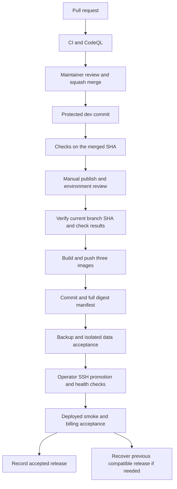
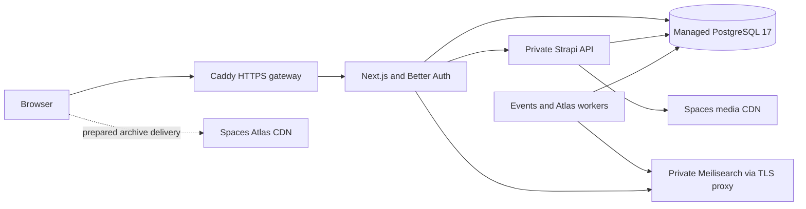

# DigitalOcean deployment and delivery

Last checked: 13 October 2026. DigitalOcean runs the deployed closed beta. GitHub validates changes and holds the prepared image publisher; an operator promotes releases over SSH. Merging a PR, publishing images and deploying the site are separate steps.

The [infrastructure record](README.md) covers resources and access. [Domain routing](domain.md) describes DNS and Caddy. Local launch acceptance is tracked in `docs/operations/digitalocean-launch-checklist.md`.

## Current state

| Layer                      | State on 13 October                                                                                                   |
| -------------------------- | --------------------------------------------------------------------------------------------------------------------- |
| Deployed application       | `release-20261013-google-auth`; UI, CMS and both workers healthy                                                      |
| Gateway                    | `WEB_MODE=beta`; HTTPS and invitation access enabled                                                                  |
| Repository                 | Public; protected `dev` is the default branch                                                                         |
| Latest merged upgrade      | [PR #16](https://github.com/webbist-js/libraries.global/pull/16), squash commit `0432ed0b`; its five PR checks passed |
| Running framework versions | Next.js 16.1.5 and Strapi 5.55.1                                                                                      |
| Merged framework versions  | Next.js 16.3.8, Better Auth 1.7.7 and official Strapi packages 5.57.0; promotion pending                              |
| GitHub image publishing    | Workflow committed; zero runs and no environment registry secret installed                                            |
| Image environment          | Owner review and `dev` only; administrator bypass is currently allowed                                                |
| Maintenance                | Billing every minute; auth retention daily at 03:00 UTC; both timers active                                           |
| Payments                   | Stripe sandbox; live purchases off; fresh-account acceptance remains                                                  |

The bootstrap deployment includes uncommitted source. Its manifest records `source_head`, `includes_uncommitted_source`, the archive checksum, file checksums and image IDs. Use that complete record when reproducing it. The Git HEAD alone does not describe the deployed build. Future image manifests record the checked Git commit and full registry digest references.

The delivery flow below includes the prepared publisher. Its activation and first accepted run remain pending.



## Runtime layout



The app Droplet runs the gateway, UI, CMS and two independent worker processes. The search Droplet has persistent Meilisearch data and a private Caddy TLS proxy. PostgreSQL has a primary and standby. Media uses a Spaces CDN. The Atlas bucket/CDN is prepared; recurring archive publishing remains to activate. Versioned backups use a private bucket.

Application Compose uses host networking. Isolation comes from loopback/private listeners, TLS, scoped credentials and Cloud Firewalls. Do not assume the Compose services have a separate bridge network. The CMS has no public administration route; use the documented SSH tunnel. TCP 80/443 serve the site. SSH is restricted to the approved operator address, and private search port 8443 accepts the app Droplet only.

## Change validation

[CI](../../.github/workflows/ci.yml) runs for PRs to `dev`/`main`, pushes to those branches and manual dispatch. Its Ubuntu 24.04 job has a 45-minute limit and read-only repository access. It uses Node from `.nvmrc`, pnpm 10.28.1 and a frozen lockfile installation with lifecycle scripts disabled.

The job runs lint, CSS/Markdown formatting, the release-source guard tests, unit/component tests, the UI production build, UI type checking including tests and the CMS production build. Example environment files and a dummy build secret are fixtures. Production credentials are not supplied to CI. Tests that boot a real Strapi/PostgreSQL instance and deployed browser acceptance remain separate from this job; the worker Docker image is built by the image publisher.

GitHub CodeQL analyzes JavaScript/TypeScript, Python and Actions. Branch rules require the CI result and code-scanning policy, resolved conversations and linear history. Contributor changes require a maintainer/code-owner review; the owner has a review-only PR bypass. Squash merges keep one commit per reviewed change. Outside contributors cannot reach production credentials through PR jobs, and third-party Actions references are pinned to full commit SHAs.

The five passing checks on the PR head are evidence for that change. A squash merge creates a new SHA. Wait for the checks on the merged `dev` commit before publishing that commit.

## Image publishing

[Production images](https://github.com/webbist-js/libraries.global/blob/dev/.github/workflows/production-images.yml) is manually dispatched on `dev`. It also requires the repository Actions variable `DO_IMAGE_PUBLISH_ENABLED=true`. The switch must be a repository variable: the job condition is evaluated before environment variables become available.

Before the first run:

1. Keep `production-images` limited to the `dev` branch and require owner review. Turn off administrator bypass. Self-review is allowed so the sole operator can approve a run they initiated; adding another trusted operator allows a separate approver later.
2. Obtain explicit owner approval to give GitHub a registry writer. Store a Docker configuration as the environment secret `DO_REGISTRY_DOCKER_CONFIG`, with a 24-hour expiry. This grants registry read/write access, not SSH or database administration. An expired credential must be refreshed before another run.
3. Confirm CI and all three CodeQL analyses have succeeded on the current merged `dev` SHA. Set the repository switch and dispatch the workflow from that branch. Approve the environment review after checking the source.

[The source guard](https://github.com/webbist-js/libraries.global/blob/dev/infra/digitalocean/verify-release-source.mjs) refuses another repository/ref, an obsolete branch head, a missing check or a latest check that is pending or unsuccessful. It checks exact SHAs and GitHub Actions app ID `15368`; matching check names alone are insufficient.

The job builds `ui`, `strapi` and `worker` sequentially for `linux/amd64` from the monorepo root, pushes `git-<full SHA>` tags and labels them with the source revision. It validates full `@sha256:` references and uploads `release-manifest.json` as a credential-free artifact retained for 14 days. Registry authentication is written outside the Docker build context with restrictive permissions and removed in an `always()` cleanup step. Publishing has a single concurrency group and does not cancel an active publish.

Tags identify a build; full manifest digests identify the artifact to deploy. Never overwrite a release tag or remove images selected by production or its rollback release. Copy accepted manifests into the longer-lived release/backup record before the Actions artifact expires. Database, bucket, OAuth, Stripe and SSH secrets stay out of GitHub image builds.

## Promotion

Production promotion is currently manual, with a single app instance. There is no automatic deployment on merge, blue/green switch, load balancer or guaranteed zero-downtime rollout. Container health checks gate startup, but users may see a short interruption.

1. Review the image manifest and confirm each image's revision label matches the selected commit. Pull full digest references using a time-limited registry reader on the server. Use the same built artifacts for acceptance and promotion.
2. Take and verify a fresh database backup. Test CMS/auth/schema changes against an isolated copy of production data, including third-party plugins. Record whether the previous images can still run against the migrated database.
3. Preserve the previous `release.env`, private runtime files and matching Compose/gateway configuration. Review changes to public build arguments separately from runtime secrets. Keep old images available.
4. Set `CMS_IMAGE`, `UI_IMAGE` and `WORKER_IMAGE` in `release.env` to the approved full digest references. On the app server:

   ```sh
   cd /opt/libraries-global
   docker compose --env-file release.env -f app.compose.yml config --quiet
   docker compose --env-file release.env -f app.compose.yml --profile workers up -d --wait
   docker compose --env-file release.env -f app.compose.yml --profile workers ps
   ```

5. Check trusted HTTPS, beta access, Google sign-in, CMS health through the tunnel, search/maps, media uploads and CDN ranges, worker health and maintenance results. Use owned disposable fixtures and clean them up. Billing acceptance uses Stripe Test mode; a signed webhook probe alone does not prove checkout settlement or membership access.
6. Record the deployed commit/digests, backup reference, runtime/configuration revision and acceptance result. Verify a rollback before calling the delivery process complete.

The next source promotion changes beta invitation-cookie signing. Existing visitors must re-enter the existing invitation password; accounts and the invitation password remain intact.

## Recovery and maintenance

An application rollback selects the previous matching images and runtime configuration, then runs the same Compose health gate. It does not reverse a database migration. If a database restore is needed, prevent application, worker and billing writes, restore the selected backup and reconcile derived search/Atlas state before reopening access. A saved release manifest is not a completed rollback rehearsal.

The static fallback is selected by `WEB_MODE=public` in `web.env`. Despite that name, it serves a temporary HTTP 503 page with `noindex` and `Retry-After`; it does not open the application to everyone. `WEB_MODE=beta` proxies to Next.js. Public launch requires a reviewed change to the application's beta and indexing controls.

Daily Droplet backups are enabled. The private versioned database backup has passed checksum verification and an isolated PostgreSQL 17 restore with matching source counts. Full Droplet restoration, application rollback and the recurring database-backup policy still need operational acceptance.

Inspect maintenance without re-running billing:

```sh
systemctl status libraries-global-billing.timer libraries-global-retention.timer
journalctl -u libraries-global-maintenance@billing.service
journalctl -u libraries-global-maintenance@retention.service
```

The maintenance wrapper calls the loopback cron endpoints with `CRON_SECRET`, fails on an unconfigured/failed billing run and journals counts. Keep credentials and provider/customer payloads out of diagnostics.

## Other workflows and next steps

| Workflow          | Role and activation                                                                                                                                      |
| ----------------- | -------------------------------------------------------------------------------------------------------------------------------------------------------- |
| `qa.yml`          | Manual deployed Playwright, accessibility, SEO and Lighthouse checks against an explicit `BASE_URL`; not a promotion gate yet                            |
| `atlas-tiles.yml` | Prepared scheduled/manual archive build on a separate Linux runner with private database access; disabled until that runner and scoped credentials exist |
| `docs.yml`        | Optional Docusaurus Pages publishing behind `DOCS_PUBLISH_ENABLED`; unrelated to the site deployment                                                     |
| `release.yml`     | Semantic-release on `main`; retained configuration, while `dev` is the current default/release-source branch and no `main` branch has been established   |

The old automatic `dev` to `main` PR workflow was removed. Dependabot PRs are reviewed changes, not automatic releases. Reconcile overlapping updates and their lockfile before merging. Update official Strapi core/plugins/providers/type generation together; do not force CMS dependency security overrides.

Before public launch: complete fresh-account sandbox billing and mailbox delivery, promote the accepted dependency upgrades, resolve reachable security advisories, add uptime/error alerts, rehearse recovery, configure the Atlas archive runner and review legal/provider copy. Keep the invitation gate and live-purchase switch under separate launch approval.
